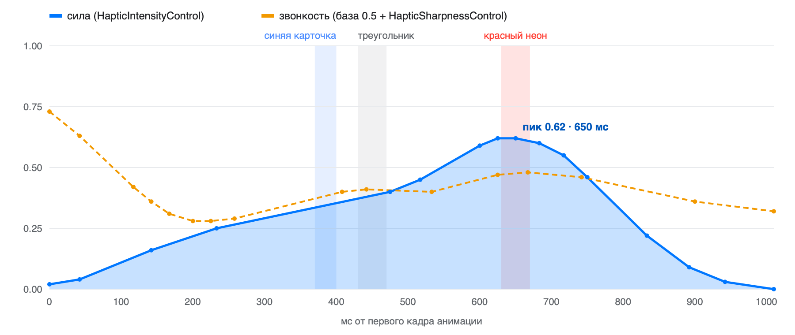

# Хаптик сплеша VK Видео · Взлёт

03.11.2026 · вариант «Взлёт · 02.11», в прототипе — `vk.takeoff2.1102`

Для сплеша VK Видео берём «Взлёт · 02.11». Это одна непрерывная вибрация длиной 1,01 с на первый цикл анимации логотипа: плавный разгон, пока свет бежит по контуру, и один пик силой 0,62 на 650 мс, когда распускается красный неон. После пика вибрация гаснет вместе со светом, к ~940 мс.



## Паттерн

| Параметр | Значение |
| --- | --- |
| Событие | одно `HapticContinuous`, с 0 до 1,01 с от первого кадра анимации |
| Базовые значения события | `HapticIntensity` = 1, `HapticSharpness` = 0.5 |
| Сила | кривая `HapticIntensityControl` (множитель к базе), 16 точек |
| Звонкость | кривая `HapticSharpnessControl` (прибавка к базе 0.5), 16 точек |
| Ощущается | с ~20 до ~940 мс (сила выше 0,03) |
| Пик силы | 0,62 на 650 мс, красный неон |
| Звонкость по ходу | первые ~100 мс 0,73 → 0,42 при почти нулевой силе, разгон 0,28–0,41, на неоне 0,48, к концу 0,32 |

16 точек на кривую — максимум Core Haptics, промежуточные значения движок вычисляет сам. Транзиентов и «зерна» нет: несколько одновременных вибраций разной звонкости на моторе дрожали друг о друга, поэтому всё сведено в одну.

Точки кривых. Звонкость дана в итоговых значениях 0…1; в AHAP и в коде она записана как прибавка к 0.5, то есть значение − 0.5.

| № | Сила: время, мс | Сила | Звонкость: время, мс | Звонкость |
| --- | --- | --- | --- | --- |
| 1 | 0 | 0.02 | 0 | 0.73 |
| 2 | 42 | 0.04 | 42 | 0.63 |
| 3 | 142 | 0.16 | 117 | 0.42 |
| 4 | 233 | 0.25 | 142 | 0.36 |
| 5 | 475 | 0.40 | 167 | 0.31 |
| 6 | 517 | 0.45 | 200 | 0.28 |
| 7 | 600 | 0.59 | 225 | 0.28 |
| 8 | 625 | 0.62 | 258 | 0.29 |
| 9 | 650 | 0.62 | 408 | 0.40 |
| 10 | 683 | 0.60 | 442 | 0.41 |
| 11 | 717 | 0.55 | 533 | 0.40 |
| 12 | 750 | 0.46 | 625 | 0.47 |
| 13 | 833 | 0.22 | 667 | 0.48 |
| 14 | 892 | 0.09 | 742 | 0.46 |
| 15 | 942 | 0.03 | 900 | 0.36 |
| 16 | 1010 | 0.00 | 1010 | 0.32 |

## Когда запускать

1. **Подготовить движок заранее.** `prepare()` вызывается при старте приложения, до показа сплеша. Холодный движок запускается с задержкой, и вибрация опаздывает к картинке.
2. **Запустить на первом кадре.** `play()` вызывается, когда первый кадр анимации уже на экране, а не когда создан экран. Все времена в кривых отсчитываются от этого кадра.
3. **Играть один раз.** Если загрузка дольше секунды и анимация повторяется, повторы идут без вибрации: повторяющийся хаптик ощущается как жужжание. Повторный `play()` код игнорирует.
4. **Дать доиграть.** Вибрация укладывается в первый цикл анимации (1 с). Когда паттерн доиграл, движок останавливается сам.
5. **Только устройства с Taptic Engine.** Core Haptics, iOS 15+. Где хаптиков нет (iPad, симулятор), вызовы ничего не делают.

## Файлы

В Swift-коде и в AHAP одни и те же значения, так что хватит одного из них. Swift не требует файла в бандле, и модуль для React Native построен на нём.

| Файл | Что это | Куда положить |
| --- | --- | --- |
| [`VKVideoSplashHaptic.swift`](VKVideoSplashHaptic.swift) | Движок, `prepare()` и `play()`, паттерн прямо в коде | iOS-таргет приложения |
| [`VKVideoSplash-Vzlet-0211.ahap`](VKVideoSplash-Vzlet-0211.ahap) | Тот же паттерн файлом | ресурсы iOS-приложения, если удобнее грузить файл |
| [`ReactNative/VKVideoSplashHapticModule.swift`](ReactNative/VKVideoSplashHapticModule.swift) | Мост: вызывает `VKVideoSplashHaptic` из JS | iOS-таргет, рядом с `VKVideoSplashHaptic.swift` |
| [`ReactNative/VKVideoSplashHapticModule.m`](ReactNative/VKVideoSplashHapticModule.m) | Регистрирует модуль в React Native | iOS-таргет |
| [`ReactNative/VKVideoSplashHaptic.ts`](ReactNative/VKVideoSplashHaptic.ts) | Обёртка для JS: `prepare()` и `play()`, на Android ничего не делает | JS-код приложения |

## iOS (Swift)

`VKVideoSplashHaptic.swift` добавляется в таргет как есть: никаких зависимостей, только CoreHaptics. Компилируется под iOS 15 в Swift 5 и Swift 6.

```swift
// При старте приложения, до показа сплеша:
VKVideoSplashHaptic.shared.prepare()

// Когда первый кадр анимации на экране:
VKVideoSplashHaptic.shared.play()
```

Если удобнее хранить паттерн файлом, AHAP играется напрямую, на том же подготовленном движке:

```swift
let url = Bundle.main.url(forResource: "VKVideoSplash-Vzlet-0211", withExtension: "ahap")!
try engine.playPattern(from: url)
```

## React Native

В React Native нет своих хаптик-паттернов: `react-native-haptic-feedback` и `expo-haptics` играют только системные пресеты. Поэтому хаптик сделан нативным модулем поверх того же Swift-кода, а JS вызывает его через тонкую обёртку.

1. В iOS-таргет приложения добавить `VKVideoSplashHaptic.swift`, `ReactNative/VKVideoSplashHapticModule.swift` и `ReactNative/VKVideoSplashHapticModule.m`. Если в проекте ещё нет Swift, Xcode предложит создать bridging header — согласиться.
2. `ReactNative/VKVideoSplashHaptic.ts` положить в JS-код.
3. `prepare()` вызвать как можно раньше, `play()` — на первом показанном кадре анимации.

```tsx
import { VKVideoSplashHaptic } from './VKVideoSplashHaptic';

// Как можно раньше, например в index.js до AppRegistry.registerComponent:
VKVideoSplashHaptic.prepare();

// В сплеше — в колбэке плеера, который срабатывает на первом показанном кадре,
// например onReadyForDisplay у react-native-video:
<Video source={splash} onReadyForDisplay={() => VKVideoSplashHaptic.play()} />
```

**Если анимация сплеша нативная** и идёт до загрузки JS-бандла, JS проснётся слишком поздно. Тогда мост не нужен: `VKVideoSplashHaptic.shared.prepare()` вызывается в `AppDelegate` при старте, а `play()` — в нативном коде, где запускается анимация.

Модуль зарегистрирован классическим способом, через `RCT_EXTERN_MODULE`. В New Architecture такие модули работают через interop-слой. Если в проекте приняты TurboModules, меняется только регистрация, вызовы остаются теми же.

## Как получены значения

Точки сняты с паттерна, который прототип играет для «Взлёта · 02.11». Для удобства время округлено до целых миллисекунд, а значения — до двух знаков. От прототипа кривая отличается максимум на ~0,005, рукой это не ощущается. Настройки варианта в прототипе:

> Взлёт · 02.11: сила 80%, звонкость 0.12 → 0.55, пролёт 0%, зерно 28% (51–76 Гц, заполнение 55%, неровность 25%), аккорд 30%, сдвиг +0 мс; зажигание 50%, искры 35%, глубина 100%, неон 100%; атака зерна 0.18, затухание зерна 0.30; ревёрб 35% на 300 мс, два пика 0%; чистый финал 100%, неон 160% (острота 1.8, звонкость 0.50), вспышка 0%, один голос 100%, плавность 40 мс, громкость 78%

## Код целиком

### `VKVideoSplashHaptic.swift`

```swift
import CoreHaptics
import Foundation

/// Хаптик сплеша VK Видео, вариант «Взлёт · 02.11».
///
/// Одна непрерывная вибрация на первый цикл анимации логотипа (1 с): плавный разгон, пока свет бежит по контуру,
/// один выраженный пик, когда распускается красный неон (650 мс), и звонкий выход — гаснет к ~940 мс вместе со светом.
/// Те же точки лежат в `VKVideoSplash-Vzlet-0211.ahap` — можно взять файл вместо этого кода.
///
/// Использование:
///     VKVideoSplashHaptic.shared.prepare()  // заранее, при старте приложения: холодный движок опаздывает
///     VKVideoSplashHaptic.shared.play()     // в момент, когда на экране первый кадр анимации
///
/// Хаптик играет один раз. Если загрузка дольше и анимация повторяется, повторы идут без вибрации.
@MainActor
final class VKVideoSplashHaptic {
    static let shared = VKVideoSplashHaptic()

    private var engine: CHHapticEngine?
    /// Плеер живёт, пока играет паттерн.
    private var player: CHHapticPatternPlayer?
    private var hasPlayed = false
    private lazy var pattern: CHHapticPattern? = try? VKVideoSplashPattern.make()

    func prepare() {
        guard engine == nil, CHHapticEngine.capabilitiesForHardware().supportsHaptics else { return }
        guard let engine = try? CHHapticEngine() else { return }
        engine.playsHapticsOnly = true
        engine.resetHandler = { [weak engine] in try? engine?.start() }
        try? engine.start()
        self.engine = engine
        _ = pattern
    }

    func play() {
        guard !hasPlayed else { return }
        hasPlayed = true
        prepare()
        guard let engine, let pattern else { return }
        try? engine.start()
        guard let player = try? engine.makePlayer(with: pattern) else { return }
        try? player.start(atTime: CHHapticTimeImmediate)
        self.player = player
        // Сплеш больше не повторит хаптик: движок можно отпустить, как только паттерн доиграет.
        engine.notifyWhenPlayersFinished { _ in .stopEngine }
    }
}

/// Паттерн «Взлёта»: одно непрерывное событие и две кривые по 16 точек — столько Core Haptics берёт на кривую.
enum VKVideoSplashPattern {
    /// От первого кадра анимации, с. Ощущается с ~20 до ~940 мс, дальше остаток меньше 3%.
    static let duration = 1.01

    /// Сила 0…1. Пик 0.62 на 650 мс, когда распускается красный неон.
    static let intensity: [(time: Double, value: Float)] = [
        (0, 0.02), (0.042, 0.04), (0.142, 0.16), (0.233, 0.25),
        (0.475, 0.40), (0.517, 0.45), (0.6, 0.59), (0.625, 0.62),
        (0.65, 0.62), (0.683, 0.60), (0.717, 0.55), (0.75, 0.46),
        (0.833, 0.22), (0.892, 0.09), (0.942, 0.03), (1.01, 0.00),
    ]

    /// Звонкость 0…1: тёплый разгон ~0.28–0.41, на неоне 0.48, к концу темнеет до 0.32.
    /// Первые ~100 мс светлее (0.73 → 0.42) — короткое мерцание, когда свет появляется в углу, но сила там ещё почти ноль.
    static let sharpness: [(time: Double, value: Float)] = [
        (0, 0.73), (0.042, 0.63), (0.117, 0.42), (0.142, 0.36),
        (0.167, 0.31), (0.2, 0.28), (0.225, 0.28), (0.258, 0.29),
        (0.408, 0.40), (0.442, 0.41), (0.533, 0.40), (0.625, 0.47),
        (0.667, 0.48), (0.742, 0.46), (0.9, 0.36), (1.01, 0.32),
    ]

    static func make() throws -> CHHapticPattern {
        // Базовые значения нейтральные, форму задают кривые: сила — множитель к 1, звонкость — прибавка к 0.5.
        let event = CHHapticEvent(eventType: .hapticContinuous, parameters: [
            CHHapticEventParameter(parameterID: .hapticIntensity, value: 1),
            CHHapticEventParameter(parameterID: .hapticSharpness, value: 0.5),
        ], relativeTime: 0, duration: duration)
        return try CHHapticPattern(events: [event], parameterCurves: [
            curve(.hapticIntensityControl, intensity) { $0 },
            curve(.hapticSharpnessControl, sharpness) { $0 - 0.5 },
        ])
    }

    private static func curve(_ id: CHHapticDynamicParameter.ID, _ points: [(time: Double, value: Float)],
                              _ map: (Float) -> Float) -> CHHapticParameterCurve {
        CHHapticParameterCurve(parameterID: id,
                               controlPoints: points.map { .init(relativeTime: $0.time, value: map($0.value)) },
                               relativeTime: 0)
    }
}
```

### `VKVideoSplash-Vzlet-0211.ahap`

```json
{
  "Version": 1.0,
  "Metadata": {
    "Project": "VK Видео — сплеш",
    "Created": "2026-11-03",
    "Description": "«Взлёт · 02.11»: одна непрерывная вибрация на первый цикл анимации логотипа (1 с). Сила — множитель к HapticIntensity = 1, звонкость — прибавка к HapticSharpness = 0.5."
  },
  "Pattern": [
    {
      "Event": {
        "Time": 0,
        "EventType": "HapticContinuous",
        "EventDuration": 1.01,
        "EventParameters": [
          { "ParameterID": "HapticIntensity", "ParameterValue": 1 },
          { "ParameterID": "HapticSharpness", "ParameterValue": 0.5 }
        ]
      }
    },
    {
      "ParameterCurve": {
        "ParameterID": "HapticIntensityControl",
        "Time": 0,
        "ParameterCurveControlPoints": [
          { "Time": 0, "ParameterValue": 0.02 },
          { "Time": 0.042, "ParameterValue": 0.04 },
          { "Time": 0.142, "ParameterValue": 0.16 },
          { "Time": 0.233, "ParameterValue": 0.25 },
          { "Time": 0.475, "ParameterValue": 0.4 },
          { "Time": 0.517, "ParameterValue": 0.45 },
          { "Time": 0.6, "ParameterValue": 0.59 },
          { "Time": 0.625, "ParameterValue": 0.62 },
          { "Time": 0.65, "ParameterValue": 0.62 },
          { "Time": 0.683, "ParameterValue": 0.6 },
          { "Time": 0.717, "ParameterValue": 0.55 },
          { "Time": 0.75, "ParameterValue": 0.46 },
          { "Time": 0.833, "ParameterValue": 0.22 },
          { "Time": 0.892, "ParameterValue": 0.09 },
          { "Time": 0.942, "ParameterValue": 0.03 },
          { "Time": 1.01, "ParameterValue": 0 }
        ]
      }
    },
    {
      "ParameterCurve": {
        "ParameterID": "HapticSharpnessControl",
        "Time": 0,
        "ParameterCurveControlPoints": [
          { "Time": 0, "ParameterValue": 0.23 },
          { "Time": 0.042, "ParameterValue": 0.13 },
          { "Time": 0.117, "ParameterValue": -0.08 },
          { "Time": 0.142, "ParameterValue": -0.14 },
          { "Time": 0.167, "ParameterValue": -0.19 },
          { "Time": 0.2, "ParameterValue": -0.22 },
          { "Time": 0.225, "ParameterValue": -0.22 },
          { "Time": 0.258, "ParameterValue": -0.21 },
          { "Time": 0.408, "ParameterValue": -0.1 },
          { "Time": 0.442, "ParameterValue": -0.09 },
          { "Time": 0.533, "ParameterValue": -0.1 },
          { "Time": 0.625, "ParameterValue": -0.03 },
          { "Time": 0.667, "ParameterValue": -0.02 },
          { "Time": 0.742, "ParameterValue": -0.04 },
          { "Time": 0.9, "ParameterValue": -0.14 },
          { "Time": 1.01, "ParameterValue": -0.18 }
        ]
      }
    }
  ]
}
```

### `ReactNative/VKVideoSplashHaptic.ts`

```typescript
import { NativeModules, Platform } from 'react-native';

/**
 * Хаптик сплеша VK Видео, вариант «Взлёт · 02.11». Только iOS (Core Haptics); на Android вызовы ничего не делают.
 *
 * - `prepare()` — заранее, как можно раньше после старта: холодный движок опаздывает к первому кадру.
 * - `play()` — в момент, когда на экране первый кадр анимации логотипа. Играет один раз за запуск:
 *   повторы анимации, пока грузится приложение, идут без вибрации.
 */
type NativeHaptic = {
  prepare(): void;
  play(): void;
};

const native: NativeHaptic | undefined =
  Platform.OS === 'ios' ? NativeModules.VKVideoSplashHapticModule : undefined;

export const VKVideoSplashHaptic = {
  prepare(): void {
    native?.prepare();
  },
  play(): void {
    native?.play();
  },
};
```

### `ReactNative/VKVideoSplashHapticModule.swift`

```swift
import Foundation

/// Мост в React Native к `VKVideoSplashHaptic` (лежит рядом, в `Handoff/VKVideoSplashHaptic.swift`).
/// В JS модуль называется `VKVideoSplashHapticModule`, его методы вызываются на главной очереди.
@objc(VKVideoSplashHapticModule)
final class VKVideoSplashHapticModule: NSObject {
    @objc static func requiresMainQueueSetup() -> Bool { true }

    /// Хаптик и движок живут на главном потоке.
    @objc var methodQueue: DispatchQueue { .main }

    @objc func prepare() {
        MainActor.assumeIsolated { VKVideoSplashHaptic.shared.prepare() }
    }

    @objc func play() {
        MainActor.assumeIsolated { VKVideoSplashHaptic.shared.play() }
    }
}
```

### `ReactNative/VKVideoSplashHapticModule.m`

```objectivec
#import <React/RCTBridgeModule.h>

// Регистрирует Swift-класс `VKVideoSplashHapticModule` как нативный модуль React Native.
@interface RCT_EXTERN_MODULE(VKVideoSplashHapticModule, NSObject)
RCT_EXTERN_METHOD(prepare)
RCT_EXTERN_METHOD(play)
@end
```
