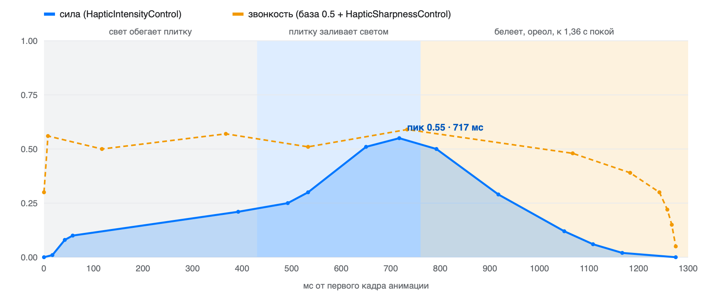
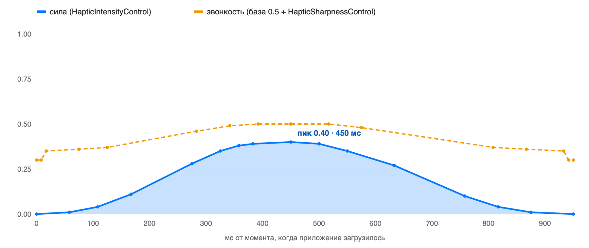

# Хаптик сплеша ВК

03.11.2026 · варианты «Основной» и «Только пик · 400 мс · 03.11», в прототипе — `main.light4` и `main.softpeak400.1103`

Для сплеша ВК два варианта на выбор:

- **«Основной»** играет с первого кадра анимации. Это одна непрерывная вибрация: она набирается, пока свет обегает плитку, доходит до пика 0,55 на 717 мс, когда плитку заливает светом, и гаснет вместе с ореолом к ~1,15 с.
- **«Только пик»** молчит, пока приложение грузится. В момент загрузки — один мягкий пик силой 0,40 через 450 мс, который гаснет к ~835 мс после загрузки.

Оба варианта — одна непрерывная вибрация с двумя кривыми, как у VK Видео. Код один на оба, вариант выбирается одной настройкой.

## «Основной»



| Параметр | Значение |
| --- | --- |
| Когда запускать | на первом кадре анимации сплеша |
| Событие | одно `HapticContinuous`, с 0 до 1,275 с от первого кадра |
| Ощущается | с ~25 мс до ~1,15 с (сила выше 0,03) |
| Пик силы | 0,55 на 717 мс, плитку заливает светом |
| Звонкость | светлая, 0,50–0,59, к концу темнеет до 0,39 |

В прототипе событие тянется до 1,9 с, но после 1,275 с сила равна нулю, поэтому пустой хвост отрезан. Звонкость в первые миллисекунды и после 1,24 с уходит к 0,30 и ниже, но сила там почти ноль, так что этого не слышно.

| № | Сила: время, мс | Сила | Звонкость: время, мс | Звонкость |
| --- | --- | --- | --- | --- |
| 1 | 0 | 0.00 | 0 | 0.30 |
| 2 | 17 | 0.01 | 8 | 0.56 |
| 3 | 42 | 0.08 | 117 | 0.50 |
| 4 | 58 | 0.10 | 367 | 0.57 |
| 5 | 392 | 0.21 | 533 | 0.51 |
| 6 | 492 | 0.25 | 733 | 0.59 |
| 7 | 533 | 0.30 | 1067 | 0.48 |
| 8 | 650 | 0.51 | 1183 | 0.39 |
| 9 | 717 | 0.55 | 1242 | 0.30 |
| 10 | 792 | 0.50 | 1258 | 0.22 |
| 11 | 917 | 0.29 | 1267 | 0.15 |
| 12 | 1050 | 0.12 | 1275 | 0.05 |
| 13 | 1108 | 0.06 |  |  |
| 14 | 1167 | 0.02 |  |  |
| 15 | 1275 | 0.00 |  |  |

## «Только пик»



| Параметр | Значение |
| --- | --- |
| Когда запускать | в момент, когда приложение загрузилось |
| Событие | одно `HapticContinuous`, с 0 до 0,95 с от загрузки |
| Ощущается | с ~95 до ~835 мс после загрузки (сила выше 0,03) |
| Пик силы | 0,40 через 450 мс после загрузки |
| Звонкость | светлеет к вершине (0,35 → 0,50) и темнеет на спаде обратно к 0,35 |

«400 мс» в названии варианта в прототипе — это пример: так прототип показывает загрузку за 400 мс. Форма пика не зависит от того, когда приложение загрузилось: при загрузке за 800 и 1200 мс она та же.

| № | Сила: время, мс | Сила | Звонкость: время, мс | Звонкость |
| --- | --- | --- | --- | --- |
| 1 | 0 | 0.00 | 0 | 0.30 |
| 2 | 58 | 0.01 | 8 | 0.30 |
| 3 | 108 | 0.04 | 17 | 0.35 |
| 4 | 167 | 0.11 | 75 | 0.36 |
| 5 | 275 | 0.28 | 125 | 0.37 |
| 6 | 325 | 0.35 | 283 | 0.46 |
| 7 | 358 | 0.38 | 342 | 0.49 |
| 8 | 383 | 0.39 | 392 | 0.50 |
| 9 | 450 | 0.40 | 450 | 0.50 |
| 10 | 500 | 0.39 | 517 | 0.50 |
| 11 | 550 | 0.35 | 575 | 0.48 |
| 12 | 633 | 0.27 | 808 | 0.37 |
| 13 | 758 | 0.10 | 867 | 0.36 |
| 14 | 817 | 0.04 | 933 | 0.35 |
| 15 | 875 | 0.01 | 942 | 0.30 |
| 16 | 950 | 0.00 | 950 | 0.30 |

16 точек на кривую — максимум Core Haptics, промежуточные значения движок вычисляет сам. Звонкость в таблицах дана в итоговых значениях 0…1; в AHAP и в коде она записана как прибавка к 0.5, то есть значение − 0.5.

## Когда запускать

1. **Подготовить движок заранее.** `prepare()` вызывается при старте приложения, до показа сплеша. Холодный движок запускается с задержкой, и вибрация опаздывает к картинке.
2. **Выбрать вариант.** `variant = .main` — «Основной», `variant = .peakOnly` — «Только пик».
3. **Сообщать оба события.** `splashDidStart()` вызывается, когда первый кадр анимации уже на экране, а не когда создан экран. `appDidLoad()` вызывается в момент, когда приложение загрузилось. Что играть, код решает сам по варианту: «Основной» стартует на первом событии, «Только пик» — на втором.
4. **Играть один раз.** Хаптик звучит один раз за запуск, повторные вызовы код игнорирует. Когда паттерн доиграл, движок останавливается сам.
5. **Только устройства с Taptic Engine.** Core Haptics, iOS 15+. Где хаптиков нет (iPad, симулятор), вызовы ничего не делают.

## Файлы

В Swift-коде и в AHAP одни и те же значения, так что хватит одного из них. Swift не требует файлов в бандле, и модуль для React Native построен на нём.

| Файл | Что это | Куда положить |
| --- | --- | --- |
| [`VKSplashHaptic.swift`](VKSplashHaptic.swift) | Движок, оба варианта, `prepare()`, `splashDidStart()` и `appDidLoad()` | iOS-таргет приложения |
| [`VKSplash-Main.ahap`](VKSplash-Main.ahap) | «Основной» файлом | ресурсы iOS-приложения, если удобнее грузить файл |
| [`VKSplash-PeakOnly.ahap`](VKSplash-PeakOnly.ahap) | «Только пик» файлом | ресурсы iOS-приложения, если удобнее грузить файл |
| [`ReactNative/VKSplashHapticModule.swift`](ReactNative/VKSplashHapticModule.swift) | Мост: вызывает `VKSplashHaptic` из JS | iOS-таргет, рядом с `VKSplashHaptic.swift` |
| [`ReactNative/VKSplashHapticModule.m`](ReactNative/VKSplashHapticModule.m) | Регистрирует модуль в React Native | iOS-таргет |
| [`ReactNative/VKSplashHaptic.ts`](ReactNative/VKSplashHaptic.ts) | Обёртка для JS, на Android ничего не делает | JS-код приложения |

## iOS (Swift)

`VKSplashHaptic.swift` добавляется в таргет как есть: никаких зависимостей, только CoreHaptics. Компилируется под iOS 15 в Swift 5 и Swift 6.

```swift
// При старте приложения, до показа сплеша:
VKSplashHaptic.shared.variant = .main  // или .peakOnly
VKSplashHaptic.shared.prepare()

// Когда первый кадр анимации сплеша на экране:
VKSplashHaptic.shared.splashDidStart()

// Когда приложение загрузилось:
VKSplashHaptic.shared.appDidLoad()
```

Если удобнее хранить паттерны файлами, AHAP играется напрямую, на том же подготовленном движке:

```swift
let url = Bundle.main.url(forResource: "VKSplash-Main", withExtension: "ahap")!  // или VKSplash-PeakOnly
try engine.playPattern(from: url)
```

## React Native

В React Native нет своих хаптик-паттернов: `react-native-haptic-feedback` и `expo-haptics` играют только системные пресеты. Поэтому хаптик сделан нативным модулем поверх того же Swift-кода, а JS вызывает его через тонкую обёртку.

1. В iOS-таргет приложения добавить `VKSplashHaptic.swift`, `ReactNative/VKSplashHapticModule.swift` и `ReactNative/VKSplashHapticModule.m`. Если в проекте ещё нет Swift, Xcode предложит создать bridging header — согласиться.
2. `ReactNative/VKSplashHaptic.ts` положить в JS-код.
3. Выбрать вариант и вызвать `prepare()` как можно раньше, а `splashDidStart()` и `appDidLoad()` — в свои моменты.

```tsx
import { VKSplashHaptic } from './VKSplashHaptic';

// Как можно раньше, например в index.js до AppRegistry.registerComponent:
VKSplashHaptic.setVariant('main'); // или 'peakOnly'
VKSplashHaptic.prepare();

// Когда первый кадр анимации сплеша на экране:
VKSplashHaptic.splashDidStart();

// Когда приложение загрузилось:
VKSplashHaptic.appDidLoad();
```

**Если анимация сплеша нативная** и идёт до загрузки JS-бандла, JS проснётся слишком поздно. Тогда мост не нужен: `VKSplashHaptic.shared.prepare()` вызывается в `AppDelegate` при старте, а `splashDidStart()` — в нативном коде, где запускается анимация.

Модуль зарегистрирован классическим способом, через `RCT_EXTERN_MODULE`. В New Architecture такие модули работают через interop-слой. Если в проекте приняты TurboModules, меняется только регистрация, вызовы остаются теми же.

## Как получены значения

Точки сняты с паттернов, которые прототип играет для этих вариантов на сплеше ВК. Для удобства время округлено до целых миллисекунд, а значения — до двух знаков. Там, где вибрация ощущается, кривые отличаются от прототипа максимум на ~0,005, рукой это не ощущается. Настройки вариантов в прототипе:

> Основной: сила 85%, кривая 1.10, звонкость 0.30 → 0.75, спад тембра 50%, зерно 0% (40–110 Гц, заполнение 60%, неровность 30%, атака 0.12, затухание 0.20); обод 0% (звонкость 0.75, зерно 100%), вспышка 40%, глубина 25%, посадка 0%, хвост 0%, течение 80% (звонкость 0.40 → 0.85, зерно 0%), основа 40%, спокойный конец 100%, один голос 100%, сдвиг -70 мс, конец 1450 мс, громкость 100%, уложить в 0 мс (хвост 0%)

> Только пик · 400 мс · 03.11: загрузка 400 мс; основа 0.00 → 0.00 за 1200 мс, появление 100 мс, звонкость 0.30; пик 0.40, подъём 450 мс, спад 500 мс, быстрый спад 0.10, звонкость 0.50 → 0.35; звонкость на подъёме от 0.35

## Код целиком

### `VKSplashHaptic.swift`

```swift
import CoreHaptics
import Foundation

/// Хаптик сплеша ВК, два варианта на выбор:
/// - «Основной» — одна непрерывная вибрация с первого кадра анимации: набирается, пока свет обегает плитку,
///   пик 0.55 на 717 мс, когда плитку заливает светом, и гаснет вместе с ореолом к ~1,15 с;
/// - «Только пик» — пока приложение грузится, тишина; в момент загрузки — один мягкий пик 0.40 через 450 мс,
///   гаснет к ~830 мс после загрузки.
/// Те же точки лежат в `VKSplash-Main.ahap` и `VKSplash-PeakOnly.ahap`.
///
/// Использование:
///     VKSplashHaptic.shared.variant = .main      // или .peakOnly
///     VKSplashHaptic.shared.prepare()            // заранее, при старте приложения: холодный движок опаздывает
///     VKSplashHaptic.shared.splashDidStart()     // в момент, когда на экране первый кадр анимации сплеша
///     VKSplashHaptic.shared.appDidLoad()         // в момент, когда приложение загрузилось
///
/// Оба события вызываются всегда, а что играть, решает `variant`. Хаптик играет один раз за запуск.
@MainActor
final class VKSplashHaptic {
    enum Variant {
        /// «Основной»: с первого кадра анимации.
        case main
        /// «Только пик»: в момент, когда приложение загрузилось.
        case peakOnly
    }

    static let shared = VKSplashHaptic()

    var variant = Variant.main

    private var engine: CHHapticEngine?
    /// Плеер живёт, пока играет паттерн.
    private var player: CHHapticPatternPlayer?
    private var hasPlayed = false

    func prepare() {
        guard engine == nil, CHHapticEngine.capabilitiesForHardware().supportsHaptics else { return }
        guard let engine = try? CHHapticEngine() else { return }
        engine.playsHapticsOnly = true
        engine.resetHandler = { [weak engine] in try? engine?.start() }
        try? engine.start()
        self.engine = engine
    }

    func splashDidStart() {
        if variant == .main { play(.main) }
    }

    func appDidLoad() {
        if variant == .peakOnly { play(.peakOnly) }
    }

    private func play(_ variant: Variant) {
        guard !hasPlayed else { return }
        hasPlayed = true
        prepare()
        guard let engine, let pattern = try? VKSplashPattern.make(variant) else { return }
        try? engine.start()
        guard let player = try? engine.makePlayer(with: pattern) else { return }
        try? player.start(atTime: CHHapticTimeImmediate)
        self.player = player
        // Больше хаптик не играет: движок можно отпустить, как только паттерн доиграет.
        engine.notifyWhenPlayersFinished { _ in .stopEngine }
    }
}

/// Паттерны ВК: у каждого одно непрерывное событие и две кривые, не больше 16 точек — столько Core Haptics берёт
/// на кривую.
enum VKSplashPattern {
    typealias Curve = [(time: Double, value: Float)]

    /// «Основной», от первого кадра анимации, с. Ощущается с ~20 мс до ~1,15 с; к 1,275 с сила доходит до нуля.
    static let mainDuration = 1.275

    /// Сила 0…1. Пик 0.55 на 717 мс, когда плитку заливает светом.
    static let mainIntensity: Curve = [
        (0, 0.00), (0.017, 0.01), (0.042, 0.08), (0.058, 0.10),
        (0.392, 0.21), (0.492, 0.25), (0.533, 0.30), (0.65, 0.51),
        (0.717, 0.55), (0.792, 0.50), (0.917, 0.29), (1.05, 0.12),
        (1.108, 0.06), (1.167, 0.02), (1.275, 0.00),
    ]

    /// Звонкость 0…1: светлая, 0.50–0.59, к концу темнеет до 0.39. В первые миллисекунды и после 1,24 с она
    /// уходит к 0.30 и ниже, но сила там почти ноль — этого не слышно.
    static let mainSharpness: Curve = [
        (0, 0.30), (0.008, 0.56), (0.117, 0.50), (0.367, 0.57),
        (0.533, 0.51), (0.733, 0.59), (1.067, 0.48), (1.183, 0.39),
        (1.242, 0.30), (1.258, 0.22), (1.267, 0.15), (1.275, 0.05),
    ]

    /// «Только пик», от момента загрузки, с. Ощущается с ~100 до ~830 мс.
    static let peakDuration = 0.95

    /// Сила 0…1. Мягкий подъём за 450 мс до 0.40 и плавный спад за 500 мс.
    static let peakIntensity: Curve = [
        (0, 0.00), (0.058, 0.01), (0.108, 0.04), (0.167, 0.11),
        (0.275, 0.28), (0.325, 0.35), (0.358, 0.38), (0.383, 0.39),
        (0.45, 0.40), (0.5, 0.39), (0.55, 0.35), (0.633, 0.27),
        (0.758, 0.10), (0.817, 0.04), (0.875, 0.01), (0.95, 0.00),
    ]

    /// Звонкость 0…1: светлеет к вершине (0.35 → 0.50) и темнеет на спаде обратно к 0.35. Крайние 0.30 приходятся
    /// на нулевую силу.
    static let peakSharpness: Curve = [
        (0, 0.30), (0.008, 0.30), (0.017, 0.35), (0.075, 0.36),
        (0.125, 0.37), (0.283, 0.46), (0.342, 0.49), (0.392, 0.50),
        (0.45, 0.50), (0.517, 0.50), (0.575, 0.48), (0.808, 0.37),
        (0.867, 0.36), (0.933, 0.35), (0.942, 0.30), (0.95, 0.30),
    ]

    static func make(_ variant: VKSplashHaptic.Variant) throws -> CHHapticPattern {
        switch variant {
        case .main: try make(duration: mainDuration, intensity: mainIntensity, sharpness: mainSharpness)
        case .peakOnly: try make(duration: peakDuration, intensity: peakIntensity, sharpness: peakSharpness)
        }
    }

    private static func make(duration: Double, intensity: Curve, sharpness: Curve) throws -> CHHapticPattern {
        // Базовые значения нейтральные, форму задают кривые: сила — множитель к 1, звонкость — прибавка к 0.5.
        let event = CHHapticEvent(eventType: .hapticContinuous, parameters: [
            CHHapticEventParameter(parameterID: .hapticIntensity, value: 1),
            CHHapticEventParameter(parameterID: .hapticSharpness, value: 0.5),
        ], relativeTime: 0, duration: duration)
        return try CHHapticPattern(events: [event], parameterCurves: [
            curve(.hapticIntensityControl, intensity) { $0 },
            curve(.hapticSharpnessControl, sharpness) { $0 - 0.5 },
        ])
    }

    private static func curve(_ id: CHHapticDynamicParameter.ID, _ points: Curve,
                              _ map: (Float) -> Float) -> CHHapticParameterCurve {
        CHHapticParameterCurve(parameterID: id,
                               controlPoints: points.map { .init(relativeTime: $0.time, value: map($0.value)) },
                               relativeTime: 0)
    }
}
```

### `VKSplash-Main.ahap`

```json
{
  "Version": 1.0,
  "Metadata": {
    "Project": "ВК — сплеш",
    "Created": "2026-11-03",
    "Description": "«Основной»: одна непрерывная вибрация с первого кадра анимации логотипа: свет обегает плитку, заливает её и гаснет к ~1,15 с. Сила — множитель к HapticIntensity = 1, звонкость — прибавка к HapticSharpness = 0.5."
  },
  "Pattern": [
    {
      "Event": {
        "Time": 0,
        "EventType": "HapticContinuous",
        "EventDuration": 1.275,
        "EventParameters": [
          { "ParameterID": "HapticIntensity", "ParameterValue": 1 },
          { "ParameterID": "HapticSharpness", "ParameterValue": 0.5 }
        ]
      }
    },
    {
      "ParameterCurve": {
        "ParameterID": "HapticIntensityControl",
        "Time": 0,
        "ParameterCurveControlPoints": [
          { "Time": 0, "ParameterValue": 0 },
          { "Time": 0.017, "ParameterValue": 0.01 },
          { "Time": 0.042, "ParameterValue": 0.08 },
          { "Time": 0.058, "ParameterValue": 0.1 },
          { "Time": 0.392, "ParameterValue": 0.21 },
          { "Time": 0.492, "ParameterValue": 0.25 },
          { "Time": 0.533, "ParameterValue": 0.3 },
          { "Time": 0.65, "ParameterValue": 0.51 },
          { "Time": 0.717, "ParameterValue": 0.55 },
          { "Time": 0.792, "ParameterValue": 0.5 },
          { "Time": 0.917, "ParameterValue": 0.29 },
          { "Time": 1.05, "ParameterValue": 0.12 },
          { "Time": 1.108, "ParameterValue": 0.06 },
          { "Time": 1.167, "ParameterValue": 0.02 },
          { "Time": 1.275, "ParameterValue": 0 }
        ]
      }
    },
    {
      "ParameterCurve": {
        "ParameterID": "HapticSharpnessControl",
        "Time": 0,
        "ParameterCurveControlPoints": [
          { "Time": 0, "ParameterValue": -0.2 },
          { "Time": 0.008, "ParameterValue": 0.06 },
          { "Time": 0.117, "ParameterValue": 0 },
          { "Time": 0.367, "ParameterValue": 0.07 },
          { "Time": 0.533, "ParameterValue": 0.01 },
          { "Time": 0.733, "ParameterValue": 0.09 },
          { "Time": 1.067, "ParameterValue": -0.02 },
          { "Time": 1.183, "ParameterValue": -0.11 },
          { "Time": 1.242, "ParameterValue": -0.2 },
          { "Time": 1.258, "ParameterValue": -0.28 },
          { "Time": 1.267, "ParameterValue": -0.35 },
          { "Time": 1.275, "ParameterValue": -0.45 }
        ]
      }
    }
  ]
}
```

### `VKSplash-PeakOnly.ahap`

```json
{
  "Version": 1.0,
  "Metadata": {
    "Project": "ВК — сплеш",
    "Created": "2026-11-03",
    "Description": "«Только пик»: один мягкий пик в момент, когда приложение загрузилось; пока грузится — тишина. Сила — множитель к HapticIntensity = 1, звонкость — прибавка к HapticSharpness = 0.5."
  },
  "Pattern": [
    {
      "Event": {
        "Time": 0,
        "EventType": "HapticContinuous",
        "EventDuration": 0.95,
        "EventParameters": [
          { "ParameterID": "HapticIntensity", "ParameterValue": 1 },
          { "ParameterID": "HapticSharpness", "ParameterValue": 0.5 }
        ]
      }
    },
    {
      "ParameterCurve": {
        "ParameterID": "HapticIntensityControl",
        "Time": 0,
        "ParameterCurveControlPoints": [
          { "Time": 0, "ParameterValue": 0 },
          { "Time": 0.058, "ParameterValue": 0.01 },
          { "Time": 0.108, "ParameterValue": 0.04 },
          { "Time": 0.167, "ParameterValue": 0.11 },
          { "Time": 0.275, "ParameterValue": 0.28 },
          { "Time": 0.325, "ParameterValue": 0.35 },
          { "Time": 0.358, "ParameterValue": 0.38 },
          { "Time": 0.383, "ParameterValue": 0.39 },
          { "Time": 0.45, "ParameterValue": 0.4 },
          { "Time": 0.5, "ParameterValue": 0.39 },
          { "Time": 0.55, "ParameterValue": 0.35 },
          { "Time": 0.633, "ParameterValue": 0.27 },
          { "Time": 0.758, "ParameterValue": 0.1 },
          { "Time": 0.817, "ParameterValue": 0.04 },
          { "Time": 0.875, "ParameterValue": 0.01 },
          { "Time": 0.95, "ParameterValue": 0 }
        ]
      }
    },
    {
      "ParameterCurve": {
        "ParameterID": "HapticSharpnessControl",
        "Time": 0,
        "ParameterCurveControlPoints": [
          { "Time": 0, "ParameterValue": -0.2 },
          { "Time": 0.008, "ParameterValue": -0.2 },
          { "Time": 0.017, "ParameterValue": -0.15 },
          { "Time": 0.075, "ParameterValue": -0.14 },
          { "Time": 0.125, "ParameterValue": -0.13 },
          { "Time": 0.283, "ParameterValue": -0.04 },
          { "Time": 0.342, "ParameterValue": -0.01 },
          { "Time": 0.392, "ParameterValue": 0 },
          { "Time": 0.45, "ParameterValue": 0 },
          { "Time": 0.517, "ParameterValue": 0 },
          { "Time": 0.575, "ParameterValue": -0.02 },
          { "Time": 0.808, "ParameterValue": -0.13 },
          { "Time": 0.867, "ParameterValue": -0.14 },
          { "Time": 0.933, "ParameterValue": -0.15 },
          { "Time": 0.942, "ParameterValue": -0.2 },
          { "Time": 0.95, "ParameterValue": -0.2 }
        ]
      }
    }
  ]
}
```

### `ReactNative/VKSplashHaptic.ts`

```typescript
import { NativeModules, Platform } from 'react-native';

/**
 * Хаптик сплеша ВК. Только iOS (Core Haptics); на Android вызовы ничего не делают.
 *
 * - `setVariant()` — какой вариант играть: `'main'` — «Основной», `'peakOnly'` — «Только пик».
 * - `prepare()` — заранее, как можно раньше после старта: холодный движок опаздывает.
 * - `splashDidStart()` — в момент, когда на экране первый кадр анимации сплеша.
 * - `appDidLoad()` — в момент, когда приложение загрузилось.
 *
 * Оба события вызываются всегда, а что играть, решает вариант. Хаптик играет один раз за запуск.
 */
export type VKSplashVariant = 'main' | 'peakOnly';

type NativeHaptic = {
  setVariant(variant: VKSplashVariant): void;
  prepare(): void;
  splashDidStart(): void;
  appDidLoad(): void;
};

const native: NativeHaptic | undefined =
  Platform.OS === 'ios' ? NativeModules.VKSplashHapticModule : undefined;

export const VKSplashHaptic = {
  setVariant(variant: VKSplashVariant): void {
    native?.setVariant(variant);
  },
  prepare(): void {
    native?.prepare();
  },
  splashDidStart(): void {
    native?.splashDidStart();
  },
  appDidLoad(): void {
    native?.appDidLoad();
  },
};
```

### `ReactNative/VKSplashHapticModule.swift`

```swift
import Foundation

/// Мост в React Native к `VKSplashHaptic` (лежит рядом, в `VK/VKSplashHaptic.swift`).
/// В JS модуль называется `VKSplashHapticModule`, его методы вызываются на главной очереди.
@objc(VKSplashHapticModule)
final class VKSplashHapticModule: NSObject {
    @objc static func requiresMainQueueSetup() -> Bool { true }

    /// Хаптик и движок живут на главном потоке.
    @objc var methodQueue: DispatchQueue { .main }

    /// `"main"` — «Основной», `"peakOnly"` — «Только пик».
    @objc func setVariant(_ variant: String) {
        MainActor.assumeIsolated { VKSplashHaptic.shared.variant = variant == "peakOnly" ? .peakOnly : .main }
    }

    @objc func prepare() {
        MainActor.assumeIsolated { VKSplashHaptic.shared.prepare() }
    }

    @objc func splashDidStart() {
        MainActor.assumeIsolated { VKSplashHaptic.shared.splashDidStart() }
    }

    @objc func appDidLoad() {
        MainActor.assumeIsolated { VKSplashHaptic.shared.appDidLoad() }
    }
}
```

### `ReactNative/VKSplashHapticModule.m`

```objectivec
#import <React/RCTBridgeModule.h>

// Регистрирует Swift-класс `VKSplashHapticModule` как нативный модуль React Native.
@interface RCT_EXTERN_MODULE(VKSplashHapticModule, NSObject)
RCT_EXTERN_METHOD(setVariant:(NSString *)variant)
RCT_EXTERN_METHOD(prepare)
RCT_EXTERN_METHOD(splashDidStart)
RCT_EXTERN_METHOD(appDidLoad)
@end
```
